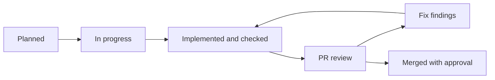

# Task and accomplishment log

Updated: 31 October 2026. Read [WORK-PLAN.md](WORK-PLAN.md) for future work. This maintained document explains changes and evidence; it is not an automatic background monitor.

## Status rules

Planned = no implementation claimed. In progress = started with remaining work stated. Implemented/awaiting review = committed on a feature branch. Merged = on shared main, not automatically live-verified. Live verification is a separate label requiring a successful actual model run. Blocked entries name the missing input and independent work still possible.

Historical test counts below describe their cited checkpoints; they are not new test runs for this documentation change.

## Accomplishment history

### H01 — Original three-agent foundation

**Merged · 29 October 2026 ·** [c5549cb](https://github.com/JoanAlbayrak/AI-Powered-Benefits-and-Leave-Management-/commit/c5549cb).

Established Enrollment, Vendor and Leave agents, deterministic checks and HR-owned transitions. **Accomplishment:** the original case workflow exists for later UI integration. **Limit:** this entry does not establish that the present model/provider configuration works live.

### H02 — Public demonstration

**Merged · 29 October 2026 ·** [PR #1](https://github.com/JoanAlbayrak/AI-Powered-Benefits-and-Leave-Management-/pull/1).

Added a browser-only GitHub Pages demonstration. **Accomplishment:** the concept can be inspected without installation. **Limit:** agent messages are examples, not live model output.

### H03 — Employee/HR interface scaffold

**Merged · 29–30 October 2026 ·** commits [9f7fa8f](https://github.com/JoanAlbayrak/AI-Powered-Benefits-and-Leave-Management-/commit/9f7fa8f), [a11376e](https://github.com/JoanAlbayrak/AI-Powered-Benefits-and-Leave-Management-/commit/a11376e), [c4ed6e4](https://github.com/JoanAlbayrak/AI-Powered-Benefits-and-Leave-Management-/commit/c4ed6e4).

Added employee-safe overview data, modular role screens, queue filtering, responsive navigation and documentation. **Accomplishment:** consistent views display records without triggering agents or changing cases. Action controls initially remained disconnected. **Recorded verification:** original handoff reports 45 Python/7 frontend tests and browser checks.

### H04 — Shared integration baseline

**Merged · 30 October 2026 ·** [51e88c0](https://github.com/JoanAlbayrak/AI-Powered-Benefits-and-Leave-Management-/commit/51e88c0).

Integrated the public demo and team changes with the new scaffold. **Accomplishment:** preserved both interfaces. **Recorded verification:** subsequent baseline reports 51 Python/7 frontend tests; this is a later checkpoint than H03.

### H05 — Agent proposal and team handoff

**Merged · 31 October 2026 ·** [PR #3](https://github.com/JoanAlbayrak/AI-Powered-Benefits-and-Leave-Management-/pull/3); commits 53c1630/a88c5d0; merge 1b3bc0e.

Added the visual report, real employer/legal references, setup instructions, contracts and execution board. **Accomplishment:** teammates can understand the domain, distinguish proposals from implementation and agree a direction. **Recorded verification:** 51 Python/7 frontend tests, documentation links and rendered PDF review. **Limit:** no successful live-model call claimed; report records legal-source access limits.

### H06 — Guarded actions and saved guidance

**Implemented / awaiting review · 31 October 2026 ·** [c26cd7b](https://github.com/JoanAlbayrak/AI-Powered-Benefits-and-Leave-Management-/commit/c26cd7b), [PR #4](https://github.com/JoanAlbayrak/AI-Powered-Benefits-and-Leave-Management-/pull/4).

Added explicit API actions, one-action coordination, scoped refresh after uncertain responses and saved employee-safe guidance/AI errors. **Accomplishment:** refresh retains explanations and a lost response does not trigger automatic duplicate submission. **Recorded verification:** 53 Python/13 frontend tests. **Limit:** browser-local coordination is not server-side idempotency or authentication.

### H07 — Connected benefits screens

**Implemented / awaiting review · 31 October 2026 ·** [5372433](https://github.com/JoanAlbayrak/AI-Powered-Benefits-and-Leave-Management-/commit/5372433), [PR #4](https://github.com/JoanAlbayrak/AI-Powered-Benefits-and-Leave-Management-/pull/4).

Connected enrollment checking, HR decisions, frozen vendor preparation, simulated sending, confirmations and drafts. **Accomplishment:** the redesigned interface supports the benefits journey; recorded HR decisions remain separate from provider status.

**Recorded verification:** 53 Python/16 frontend tests; browser checks of E2002's journey, E2001's approval block/information request, employee visibility and E2004's mismatch/pending results. No warnings/errors in inspected browser logs; checked vendor page had no horizontal overflow at 390px. Screenshot capture was unavailable, so pixel-level review remains open.

**Limits:** browser testing exercised unavailable-AI fallback; fake clients tested structured generated output. No successful live-model call, specialist consultation, new leave submission or external transmission claimed.

### H08 — Benefits review instructions

**Implemented / awaiting review · 31 October 2026 ·** [1f4bc09](https://github.com/JoanAlbayrak/AI-Powered-Benefits-and-Leave-Management-/commit/1f4bc09), [PR #4](https://github.com/JoanAlbayrak/AI-Powered-Benefits-and-Leave-Management-/pull/4).

Updated status/setup documents and a reproducible walkthrough. **Accomplishment:** a reviewer can reproduce the integration and identify unfinished work. PR #4 was open when this log was prepared. Do not mark H06-H08 merged without checking the actual merge event.

### H09 — Numbered work plan and task log

**Documented / awaiting review · 31 October 2026 · branch docs/prioritized-plan-and-task-log · [PR #5](https://github.com/JoanAlbayrak/AI-Powered-Benefits-and-Leave-Management-/pull/5).**

Added priorities, dependencies, acceptance criteria, suggested two-person workstreams and program/dependency diagrams. **Accomplishment:** future work and completed milestones can be understood without reconstructing the chat. Application behavior was unchanged; application tests were not rerun solely for this documentation update. Documentation links are checked before publishing.

### T01 — Technical baseline review and regression fix

**Date/owner:** 31 October 2026; Codex implementation/review, human approval pending.

**Status:** technical work complete; committed and published; not merged. [PR #6](https://github.com/JoanAlbayrak/AI-Powered-Benefits-and-Leave-Management-/pull/6) targets `feat/connect-benefits-workflow` (PR #4), rather than main. The task checkbox records technical completion only.

**Purpose:** check the benefits integration before deeper agent work.

**Finding:** an already-decided enrollment still invoked AI before returning its saved case, wasting a request and potentially pairing fresh guidance with an old decision.

**Changed:** check case state before agent execution; return the saved enrollment/guidance/error for decided/provider states. Keep open/information-requested cases recheckable. Updated `workflow.py`, static-demo mirror, generated public page and regression/parity tests.

**Accomplished:** rechecking a decided case preserves its original facts, decision, history and handoff without another model request, including when underlying elections later change.

**Verified:** fresh run of 55 Python tests and 16 frontend tests passed; whitespace checks passed. Regression checks cover all decided/provider states, no added model requests, unchanged case/history, endpoint consistency and continued information-request rechecking. Existing workflow tests cover E2002, E2001 guards, E2004 reconciliation and frozen handoffs. These are fake-model/deterministic checks; no new live-model or screenshot verification claimed.

**Evidence:** fix [3104dc6](https://github.com/JoanAlbayrak/AI-Powered-Benefits-and-Leave-Management-/commit/3104dc6); review record [07c4461](https://github.com/JoanAlbayrak/AI-Powered-Benefits-and-Leave-Management-/commit/07c4461); [review details](https://github.com/JoanAlbayrak/AI-Powered-Benefits-and-Leave-Management-/blob/review/t01-benefits-baseline/docs/T01-REVIEW.md).

**Limits:** PR #4/#6 remain unmerged. The proposed continuation base is `07c4461` above `1f4bc09`; this does not claim shared main or human approval. Live-model setup remains unfinished. No direct main push or external provider sending occurred.

**Next:** T02 runtime configuration/readiness on a new task branch. Actual live verification requires the supplied provider key.

## Current task register

| ID | Status | Next action / missing input |
|---|---|---|
| T01 | Technical review complete; fix awaiting approval | Review PR #6 into PR #4 branch; no merge performed |
| T02 | Planned; live validation needs key | Confirm provider; prepare setup/readiness |
| T03 | Planned | Agree evidence/policy/snapshot records |
| T04 | Planned | Build on T03; fake-model work can proceed before key |
| T05 | Planned | Add bounded specialist consultation |
| T06 | Planned | Agree leave draft/confirmation boundary |
| T07 | Planned | Display actual structured agent activity |
| T08 | Planned | Check integrated and failure scenarios |
| T09 | Planned; needs working key/model | Two clean-start live rehearsals |
| T10 | Planned | Finish reviews and handoff instructions |

## Updating this log

Update at every meaningful checkpoint and include the entry in its related commit/PR. Keep stable IDs from the work plan. Add dated entries rather than erasing previous results. Record partial progress, blockers, review and merge events separately. Distinguish fake-model checks from live runs. Never include secrets, real medical data or hidden model reasoning. Owners remain unassigned until agreed.

Use this entry template:

```text
Task ID and title:
Date and owner:
Status:
Purpose: problem addressed
Changed: concrete behavior and files/data/contracts affected
Accomplished: what a user or component can now do
Verified: exact checks/results; fake model or live model
Evidence: branch, commit and PR
Limits/blockers:
Next action:
```



Live verification is an independent label: a branch may be tested live before merging, and a merged change may still lack live validation.
