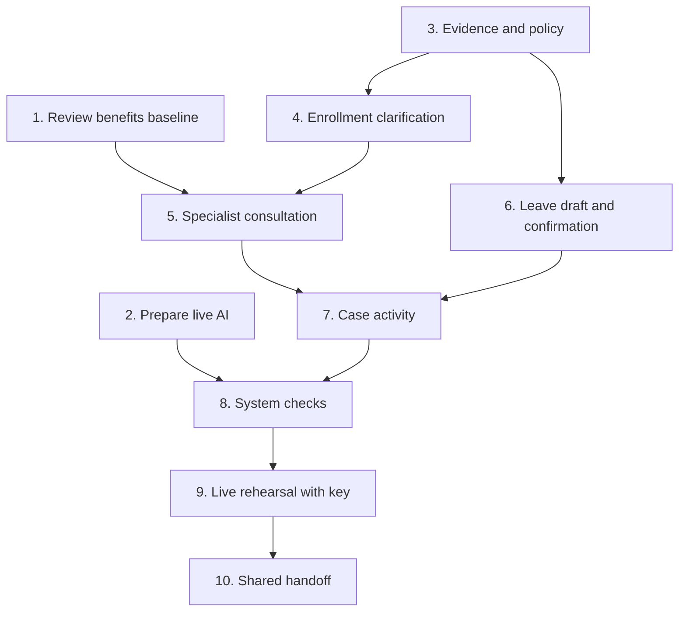
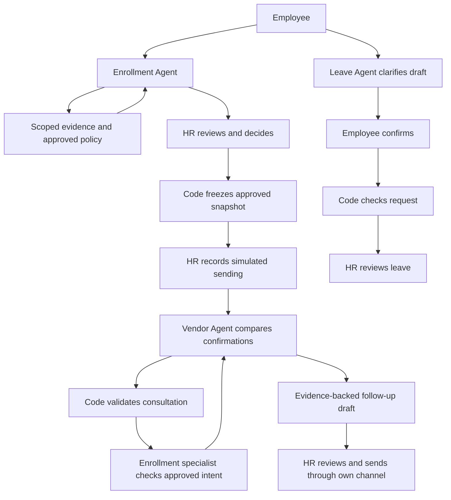

# Prioritized work plan

Updated: 31 October 2026. Target: live presentation on Monday, 2 November. This document plans the work; [TASK-LOG.md](TASK-LOG.md) records accomplishments. This update changes documentation only.

## Current position

The original app, three scoped agents, redesigned scaffold and proposal are on main. The connected benefits journey is implemented in [PR #4](https://github.com/JoanAlbayrak/AI-Powered-Benefits-and-Leave-Management-/pull/4), still open at this checkpoint. Its recorded validation is 53 Python and 16 frontend tests. Live-model success, evidence clarification, specialist consultation and the new leave submission remain unfinished.

## Task checklist

Checks indicate technical task completion, not a merge or human approval. PR status is recorded separately in the log.

- [x] T01 — Technical benefits baseline review and regression fix. [PR #6](https://github.com/JoanAlbayrak/AI-Powered-Benefits-and-Leave-Management-/pull/6); human acceptance and merges remain pending.
- [ ] T02 — Prepare live AI configuration and verify with the supplied key.
- [ ] T03 — Scoped evidence, approved policy and snapshot references.
- [ ] T04 — Enrollment clarification loop.
- [ ] T05 — Vendor-to-Enrollment consultation.
- [ ] T06 — Leave draft, confirmation and HR review.
- [ ] T07 — Case agent activity.
- [ ] T08 — Cross-workflow and failure checks.
- [ ] T09 — Two live rehearsals.
- [ ] T10 — Final reviewed handoff.

## Numbered tasks in execution order

Must = required for the intended live multi-agent presentation. Should = useful but can be simplified. Estimates are remaining person-hours, not guaranteed elapsed time. Owners are unassigned until agreed.

| Task | Priority | Estimate | Dependency | Current status |
|---|---|---|---|---|
| 1 / T01 Review the existing benefits journey | Must | 30 min | PR #4 | Technical review complete; fix PR #6 awaits approval |
| 2 / T02 Prepare live AI configuration | Must | 1 h | Confirm provider; key for live validation | Planned |
| 3 / T03 Add scoped evidence, policy and snapshot references | Must | 1.5 h | Agree contracts | Planned |
| 4 / T04 Enrollment clarification loop | Must | 2 h | T03 | Planned |
| 5 / T05 Vendor-to-Enrollment consultation | Must | 2.5 h | T01, T03, T04 | Planned |
| 6 / T06 Leave draft, confirmation and HR review | Must | 2 h | T03; reuse T04 pattern | Planned |
| 7 / T07 Clear agent activity inside the case | Should | 1 h | T05, T06 | Planned |
| 8 / T08 Cross-workflow and failure tests | Must | 1.5 h | Implemented T02-T07 | Planned |
| 9 / T09 Rehearse using the actual key/model | Must | 1 h | T02, T05, T06, T08; working key | Planned |
| 10 / T10 Final review and presentation handoff | Must | 30 min | T08, T09 | Planned |

About 13.5 person-hours plus 3 hours of integration buffer remain. Prepare runtime configuration and fake-model tests before the key arrives; successful live validation still needs the actual key.

## Task 1 — Review the benefits baseline

**Why:** agree on a shared working base before extending it.

- Follow E2002: enrollment check → HR approval → vendor preparation → simulated sending → confirmation review.
- Confirm E2001 cannot be approved while incomplete. Inspect E2004's approved employee-only tier versus its family-tier carrier reply.
- Review frontend action modules, workflow guards and employee-safe projections in PR #4.
- **Completion:** technical review findings are resolved on `review/t01-benefits-baseline` at `07c4461` (fix `3104dc6`), based on implementation `1f4bc09`. This is the proposed continuation base; team acceptance and merges remain pending. Merge only with explicit approval.
- **Log:** findings, fixes, branch/PR, agreed base and merge status.

## Task 2 — Prepare private key and model setup

**Why:** the presenter should supply a private key without editing application logic.

- Confirm provider: the current runtime uses Anthropic; another provider needs an adapter decision.
- Prepare configurable model selection, supported SDK calls, bounded timeout/retries and a clear readiness check.
- Keep credentials in ignored local configuration, never browser code, GitHub or the log. Page browsing must not make model calls.
- **Files:** runner, environment example, runtime tests and setup instructions.
- **Done:** missing/invalid configuration gives a useful error; deterministic results remain available; a supported configured model produces structured output once the key is supplied. Track setup and live verification separately.
- **Log:** configuration behavior, model identifier, test evidence and unresolved access issues; never the secret.

## Task 3 — Add trustworthy evidence and policy

**Why:** agents need facts to investigate rather than guessing from prompts.

- Add fictional absent/received/verified evidence metadata scoped to employee and case.
- Add a small approved demo policy library with source, version, applicability and effective dates. Label synthetic employer rules.
- Add stable references for frozen approved snapshots. Agree how new evidence states map to the existing proof_received field without weakening guards.
- **Files:** fictional data, checks, workflow and scoped read tools. Agree payloads before parallel UI work.
- **Done:** tools return the correct version and scope; wrong-person/wrong-snapshot requests are rejected; missing policy stays unknown.
- **Log:** records/fields added, compatibility decisions and scope tests.

## Task 4 — Enrollment Agent investigates and clarifies

**Why:** answer “I already uploaded it” usefully instead of repeating a checklist.

- Retrieve evidence and policy; ask one focused question when necessary; preserve clarification context.
- Keep received separate from verified and employee claims separate from trusted records.
- Add a small help panel. A conversation must not change approval state or issue a formal HR notice.
- **Files:** Enrollment Agent tools, workflow context, API projection and employee view.
- **Done:** absent, received and verified cases lead to different grounded next steps without exposing HR-only notes.
- **Log:** input, evidence retrieved, answer/question, verification and unresolved facts.

## Task 5 — Real specialist collaboration

**Why:** demonstrate a useful multi-agent system, not just three labels.

- Vendor Agent requests an Enrollment finding about frozen approved intent, routed by existing workflow code. No fourth AI manager.
- Code validates employee/case/snapshot. Initially allow one specialist consultation per vendor run, no recursive callbacks, and bounded total model work.
- Return findings, evidence references and unknowns. Vendor incorporates the response in its final finding/follow-up draft; HR reviews and sends externally.
- **Files:** agents, runner budgets, workflow routing and boundary tests.
- **Done:** the consultation substantiates or changes the final draft; failure remains an explicit unknown. Fake-model routing tests precede actual live proof in T09.
- **Log:** request/reply, sources, effect on final output, call count and failure behavior. Never hidden model reasoning.

## Task 6 — New leave journey

**Why:** turn an unclear request into an employee-confirmed packet for HR.

- Clarify required dates/type/schedule; show a structured draft; require explicit confirmation before formal submission.
- Connect existing leave checks and HR review. Separate clarification from official requests/notices.
- Failed employment lookups remain “cannot determine.” Failed FMLA basics must not automatically deny every leave option.
- **Files:** Leave Agent, draft workflow/API and employee leave view. No real medical uploads.
- **Done:** a synthetic request moves from draft through confirmation to HR review and the correct employee sees the permitted update.
- **Log:** transitions, clarification, HR outcome, tests and limits.

## Task 7 — Show understandable agent activity

**Why:** a viewer should understand who acted and what happens next.

- Show actor, action, useful finding, evidence, unknowns and next step inside the existing case.
- Include the Vendor → Enrollment question/reply. Keep employee-visible activity separate from internal HR detail.
- Use existing components; no new dashboard or decorative agent animation.
- **Done:** a first-time viewer can explain why consultation occurred and what HR must do next.
- **Log:** role visibility and accessibility/layout checks.

## Task 8 — Check the complete system

- Check approval guards, wrong-person access, frozen snapshots, missing evidence/policy, duplicate actions, lost responses and consultation limits.
- Confirm unavailable AI preserves code results and is not labeled live AI.
- Run relevant automated and browser checks, including keyboard, narrow layout and recoverable errors.
- **Done:** defined scenarios pass and remaining failures have a recorded impact and owner. Test counts alone do not establish live-model quality.
- **Log:** exact checks/results, fixes, commit/PR and remaining risks.

## Task 9 — Rehearse the live demonstration

- Use the supplied key for two clean-start runs: enrollment clarification → HR approval → vendor issue → specialist consultation; then leave clarification → employee confirmation → HR review.
- Check actual model output, sources, response time and fallback messages. Use fictional records only.
- Keep the presentation around seven minutes. If live access fails, report the limitation; never present canned prose as live collaboration.
- **Done:** both live runs succeed, or the exact unmet requirement is documented. A recording is not the planned deliverable.
- **Log:** date, non-secret configuration/model identifier, results/timing and demo risks.

## Task 10 — Shared handoff

- Resolve review findings, update setup/demo notes, publish feature PRs and record merge status accurately. No direct main push or automatic merge.
- Document actual limits, including in-memory case resets.
- **Done:** a teammate can start the app and reproduce the presentation route from instructions alone.
- **Log:** branch/commit/PR, review outcome and remaining work.

## Suggested two-person split

These are workstreams, not assignments to a named person.

| Workstream 1 — Agent logic and data | Workstream 2 — Interface and integration |
|---|---|
| T02 runtime; T03 data/contracts | Review T01 journey; agree payloads |
| T04/T05 tools and consultation | T04 help panel; T07 activity |
| T06 draft API and agent behavior | T06 confirmation/submission screens |
| Scope, budget and transition tests | Browser, error and visibility checks |

Coordinate shared workflow.py/web.py edits under one owner and app.js under another. Agree contracts first and integrate after T03, T05 and T06, not at the presentation deadline.

## Task dependency diagram

## Intended program flow

This is the proposed full flow. Evidence clarification, specialist consultation and the new leave path are not implemented yet. Existing benefits wiring is in PR #4.

## Schedule and scope

Use remaining Saturday time for baseline review, runtime preparation, evidence and consultation. Use Sunday for leave integration, case activity, system checks and live rehearsals. Reserve the final block for fixes. Simplify optional display polish first if time slips; do not drop consultation or live validation while claiming a finished live multi-agent demo.

No new agent platform, AI manager, production login, real carrier/payroll connection, real medical uploads or redesign. Update the task log at meaningful checkpoints, including partial progress and blockers.
